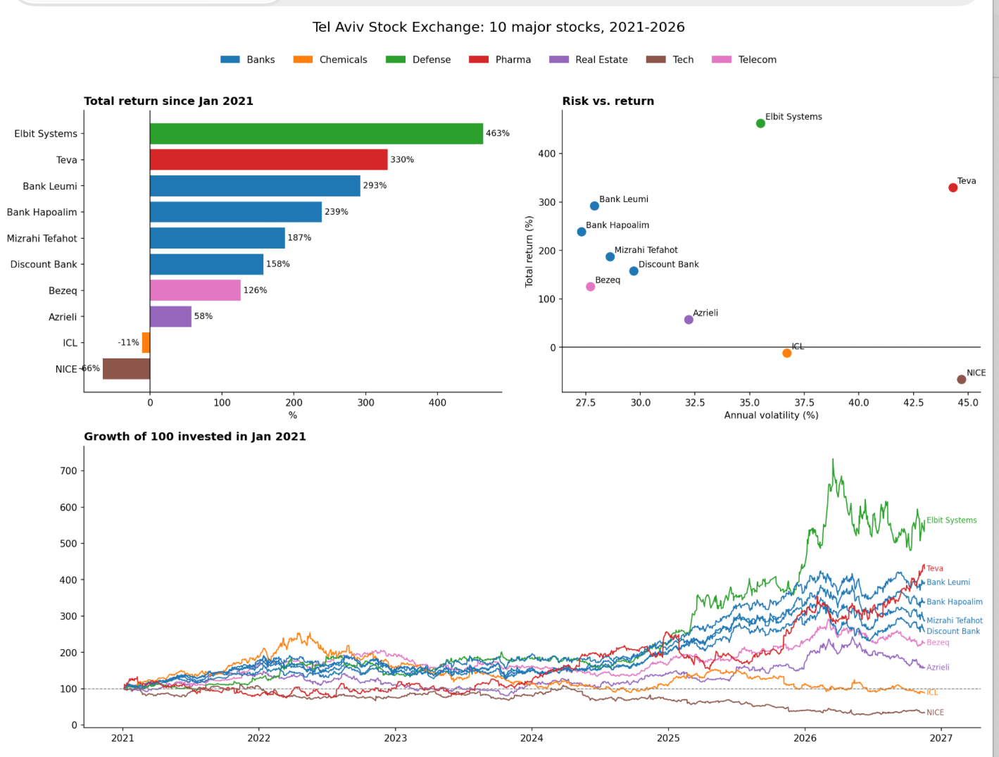

# TASE Stock Performance Analysis

**Goal:** Compare the performance and risk of 10 major Tel Aviv Stock Exchange stocks across sectors, from January 2021 to November 2026.

**Tools:** SQL (SQLite – JOINs, CTEs, window functions), Python (Pandas, Matplotlib, yfinance)

**Data:** Daily closing prices from Yahoo Finance, adjusted for dividends and splits.

👉 [View the full notebook on Kaggle](https://www.kaggle.com/code/edenalhazov/tase-stock-performance-analysis)

## Key Findings

1. **Defense and pharma led.** Elbit Systems returned 464% and Teva 329% since January 2021.
2. **Banks delivered the best risk-adjusted performance.** All four major banks returned 161%–297% with the lowest volatility in the group (27%–30%).
3. **High risk did not guarantee high return.** Teva and NICE had almost identical volatility (~44%), yet Teva gained 329% while NICE lost 66%.
4. **Only two of ten stocks lost value:** NICE (-66%) and ICL (-11%).

## Approach

1. Downloaded daily prices with `yfinance` and stored them in two SQL tables (`prices`, `stocks`).
2. Calculated total return per stock using a CTE and multiple JOINs.
3. Calculated annualized volatility from daily returns using the `LAG()` window function.
4. Built a 3-panel dashboard: total return, risk vs. return, and growth of 100 invested.
